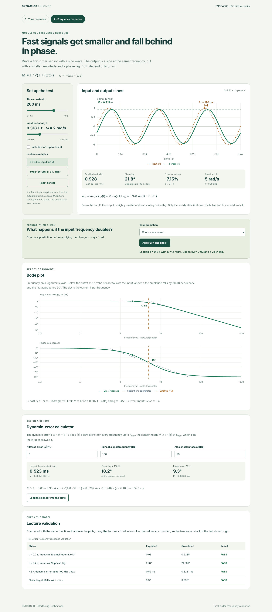
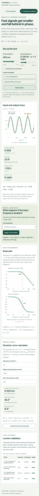

# ENCS4380 Dynamic Characteristics Toolkit — Klombo

Interactive sensor models for Interfacing Techniques at Birzeit University.

[Live GitHub Pages site](https://dana-dawadi.github.io/encs4380-dynamics-klombo/)

Modules 1 and 2 are implemented. Use the tabs at the top of the page to switch modules.

## Team and scope

Team: Aseel Hamed, Ahmad Khdair, Muhammad Herzallah, and Dana Dawadi.

| Module | Owner |
| --- | --- |
| 1 — First-order time response | Ahmad Khdair |
| 2 — First-order frequency response | Aseel Hamed |
| 3 — Second-order response and state-space panel | Muhammad Herzallah |
| 4 — Guess the sensor challenge | Dana Dawadi |

The current implementation covers Modules 1 and 2 and a small hash router that switches between them. Modules 3 and 4 are assigned as shown above and remain for their owners to implement.

## Module 1

- Step and ramp inputs with live gain K, time constant τ, and amplitude/ramp-rate sliders.
- Closed-form response curves, labelled input and ideal-output references, and step markers at τ and 3τ.
- Ramp asymptotic time lag τ and steady dynamic error Krτ, explicitly measured against Kx. For K ≠ 1, raw error x − y is not constant.
- Step error fraction on a logarithmic vertical axis. Natural-log slope is −1/τ; base-10 slope is −1/(τ ln 10).
- A prediction activity that applies a doubled τ and explains the result.
- Visible expected/calculated/pass validation for the lecture's rounded 63.2% and 95% checks.
- Responsive layout, keyboard controls, text equivalents for graph landmarks, and a reset button.

### Equations and assumptions

The sensor starts at rest: y(0) = 0. K, τ, and input size are positive. Inputs start at t = 0.

For a step x(t) = A:

`y(t) = KA [1 − exp(−t/τ)]`

For a ramp x(t) = rt:

`y(t) = Kr [t − τ + τ exp(−t/τ)]`

The plot covers 0–6τ and updates its seconds labels as τ changes. A larger τ therefore stretches the physical time scale even though the normalized curve has the same shape. The ramp guide joins points on Kx and its delayed asymptote; it is not a claim that the transient has already vanished.

At τ the exact response fraction is 0.6321205588; at 3τ it is 0.9502129316. The visible validation allows ±0.0005 because the homework rounds these to 0.632 and 0.95. Exact 95% time is −τ ln(0.05), approximately 2.996τ.

Reference: ENCS4380 Homework 1, Dynamic Characteristics Interactive Toolkit, Modules 1 and validation check 1; *Static and Dynamic Characteristics* lecture, first-order sensor step and ramp responses (slide 34). Course reference files remain outside this repository.

## Module 2

- Log-scale sliders for τ (0.1 ms–10 s) and input frequency f (0.01–1000 Hz)
- Input and output sines on one plot, with the amplitude ratio M drawn as a line and the output delay Δt = |φ|/ω marked between matching peaks. An optional start-up transient shows the response from rest.
- Live amplitude ratio (also in dB), phase lag, dynamic error δ = M − 1, and cutoff ω = 1/τ.
- Bode magnitude (dB) and phase on a logarithmic frequency axis, with the cutoff marked at −3 dB and −45°, the straight-line asymptotes, and the current frequency.
- Dynamic-error calculator: allowed error and highest frequency give τmax, with the working shown, and the phase lag at a second frequency. The result can be loaded into the plots when it fits the slider ranges; otherwise the page explains why it cannot be loaded.
- Predict, then check: the user predicts what doubling the frequency does, then the page applies it and reports the change in M, the phase lag angle and the time delay. The angle grows but the delay in seconds shrinks, because each cycle is shorter.


### Equations

For x(t) = A sin(ωt) and G(s) = K/(τs + 1):

`M = 1 / √(1 + (ωτ)²)`, `φ = −tan⁻¹(ωτ)`, `δ = M − 1`

Steady state: `y(t) = KAM sin(ωt + φ)`. From rest the full response adds `−KAM sin(φ) e^(−t/τ)`.

For |δ| ≤ e up to ω: `τmax = √(1/(1 − e)² − 1) / ω`. With e = 0.05 and f = 100 Hz this gives τmax = 0.523 ms, and the lag at 50 Hz is 9.33°.

The page uses K = 1 and A = 1, so the plotted output amplitude equals M.

## Run locally

No build step, CDN, login, or backend is required. Serve the repository with any static HTTP server, for example:

```sh
python -m http.server 8000
```

Open `http://localhost:8000/`. Use HTTP rather than opening the HTML as a local file because browsers restrict ES module imports on `file:` URLs. All application asset paths are relative so the site works under the GitHub Pages repository prefix.

## Structure and integration

- `index.html`: page shell, module tabs, and a hash router (`#module1`, `#module2`) that calls each module's cleanup before mounting the next.
- `modules/module1/index.js`: `mount(root)` renders the module and returns a cleanup function. A future router should call cleanup before changing modules.
- `modules/module1/math.js`: pure, validated equations with no DOM dependency.
- `styles/site.css`: shared page shell and base styles.
- `modules/module1/styles.css`: module styles scoped under `.module-one`.
- `tests/module1.test.js`: equation and parameter tests using Node's built-in test runner.
- `tests/browser.mjs`: browser interaction and layout checks with a local static server.
- `modules/module2/index.js`, `math.js`, `styles.css`: Module 2, same `mount(root)` interface, styles scoped under `.module-two`.
- `tests/module2.test.js`: Module 2 equation tests (cutoff, ODE residual of the sine response, τmax, lecture values, invalid input).
- `tests/browser-module2.mjs`: Module 2 browser checks, including navigation and phone layout.

To add a module: create `modules/moduleN/` with the same `mount(root)`/cleanup interface, add its stylesheet to `index.html`, and add one entry to `routes` and one tab link. There are no placeholder tabs for unfinished modules.

## Verification

With Node.js installed:

```sh
npm test
```

This checks the step landmarks and gain scaling, ramp ODE residual and asymptote, small-time numerical stability, logarithm slopes, and invalid parameters.

For the browser checks, install Playwright locally without adding a production dependency:

```sh
npm install --no-save playwright
npx playwright install chromium
node tests/browser.mjs
node tests/browser-module2.mjs
```

The browser runner also accepts `PLAYWRIGHT_PATH` and `BROWSER_EXECUTABLE` for an existing installation. It exercises the site under a repository-style URL prefix and saves desktop and phone screenshots.

See [the verification record](docs/VERIFICATION.md) for the requirement-to-test mapping, executed results, and testing limits.

Module 1 tracking: [Issue #1](https://github.com/dana-dawadi/encs4380-dynamics-klombo/issues/1).

## Screenshots






## Assistance disclosure

OpenAI Codex assisted with Module 1 implementation, documentation, and automated tests. Claude assisted with the Module 2 implementation, its tests, and documentation.
