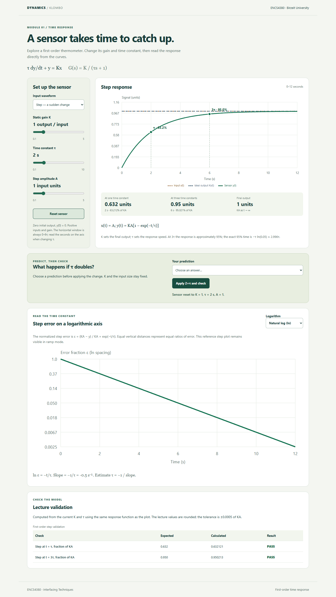
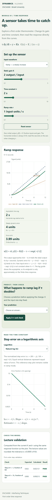

# ENCS4380 Dynamic Characteristics Toolkit — Klombo

Interactive sensor models for Interfacing Techniques at Birzeit University.

[Live GitHub Pages site](https://dana-dawadi.github.io/encs4380-dynamics-klombo/)

Module 1 is implemented on this feature branch. The live site updates only after the pull request is reviewed and merged into `main`.

## Team and scope

Team: Aseel Hamed, Ahmad Khdair, Muhammad Herzallah, and Dana Dawadi.

Module 1 (first-order time response): Ahmad Khdair. Module 2–4 ownership is not recorded here yet. This change implements only Module 1 and the minimal shared page needed to open it; it does not implement the other modules.

## Module 1

- Step and ramp inputs with live gain K, time constant τ, and amplitude/ramp-rate sliders.
- Closed-form response curves, labelled input and ideal-output references, and step markers at τ and 3τ.
- Ramp asymptotic time lag τ and steady dynamic error Krτ, explicitly measured against Kx. For K ≠ 1, raw error x − y is not constant.
- Step error fraction on a logarithmic vertical axis. Natural-log slope is −1/τ; base-10 slope is −1/(τ ln 10).
- A prediction activity that applies a doubled τ and explains the result.
- Visible expected/calculated/pass validation for the lecture's rounded 63.2% and 95% checks.
- Responsive layout, keyboard controls, text equivalents for graph landmarks, and a reset button.

### Equations and assumptions

The sensor starts at rest: y(0) = 0. K, τ, and input size are positive. Inputs start at t = 0.

For a step x(t) = A:

`y(t) = KA [1 − exp(−t/τ)]`

For a ramp x(t) = rt:

`y(t) = Kr [t − τ + τ exp(−t/τ)]`

The plot covers 0–6τ and updates its seconds labels as τ changes. A larger τ therefore stretches the physical time scale even though the normalized curve has the same shape. The ramp guide joins points on Kx and its delayed asymptote; it is not a claim that the transient has already vanished.

At τ the exact response fraction is 0.6321205588; at 3τ it is 0.9502129316. The visible validation allows ±0.0005 because the homework rounds these to 0.632 and 0.95. Exact 95% time is −τ ln(0.05), approximately 2.996τ.

Reference: ENCS4380 Homework 1, Dynamic Characteristics Interactive Toolkit, Modules 1 and validation check 1; *Static and Dynamic Characteristics* lecture, first-order sensor step and ramp responses (slide 34). Course reference files remain outside this repository.

## Run locally

No build step, CDN, login, or backend is required. Serve the repository with any static HTTP server, for example:

```sh
python -m http.server 8000
```

Open `http://localhost:8000/`. Use HTTP rather than opening the HTML as a local file because browsers restrict ES module imports on `file:` URLs. All application asset paths are relative so the site works under the GitHub Pages repository prefix.

## Structure and integration

- `index.html`: minimal page shell and Module 1 entry point.
- `modules/module1/index.js`: `mount(root)` renders the module and returns a cleanup function. A future router should call cleanup before changing modules.
- `modules/module1/math.js`: pure, validated equations with no DOM dependency.
- `styles/site.css`: shared page shell and base styles.
- `modules/module1/styles.css`: module styles scoped under `.module-one`.
- `tests/module1.test.js`: equation and parameter tests using Node's built-in test runner.
- `tests/browser.mjs`: browser interaction and layout checks with a local static server.

Future modules can live alongside `module1` and expose the same `mount(root)`/cleanup interface. There are no placeholder navigation buttons for unfinished modules.

## Verification

With Node.js installed:

```sh
npm test
```

This checks the step landmarks and gain scaling, ramp ODE residual and asymptote, small-time numerical stability, logarithm slopes, and invalid parameters.

For the browser checks, install Playwright locally without adding a production dependency:

```sh
npm install --no-save playwright
npx playwright install chromium
node tests/browser.mjs
```

The browser runner also accepts `PLAYWRIGHT_PATH` and `BROWSER_EXECUTABLE` for an existing installation. It exercises the site under a repository-style URL prefix and saves desktop and phone screenshots.

See [the verification record](docs/VERIFICATION.md) for the requirement-to-test mapping, executed results, and testing limits.

Module 1 tracking: [Issue #1](https://github.com/dana-dawadi/encs4380-dynamics-klombo/issues/1).

## Screenshots





## Assistance disclosure

OpenAI Codex assisted with Module 1 implementation, documentation, and automated tests. Team members must review the code and be able to explain its equations and behavior in the course demo.
