# ENCS4380 Dynamics and Control Toolkit — Klombo

Interactive sensor models (Homework 1) and PID control (Homework 2) for Interfacing Techniques at Birzeit University.

[Live GitHub Pages site](https://dana-dawadi.github.io/encs4380-dynamics-klombo/)

Homework 1 Modules 1–4 and Homework 2 Modules P1 and P2 are implemented. The navigation at the top of the page has two sections: **Dynamics · HW1** and **Control · HW2**.

## Team and scope

Team: Aseel Hamed, Ahmad Khdair, Muhammad Herzallah, and Dana Dawadi.

| Module | Owner |
| --- | --- |
| 1 — First-order time response | Ahmad Khdair |
| 2 — First-order frequency response | Aseel Hamed |
| 3 — Second-order response and state-space panel | Muhammad Herzallah |
| 4 — Guess the sensor challenge | Dana Dawadi |

### Homework 2 — PID Control

| Module | Owner |
| --- | --- |
| P1 — PID playground | Aseel Hamed |
| P2 — A slow sensor in the loop | Ahmad Khdair |
| P3 — Digital PID | Muhammad Herzallah |
| P4 — Tuning challenge | Dana Dawadi |
| My system (Micromouse drive motor) | To be assigned |

## Module 1

- Step and ramp inputs with live gain K, time constant τ, and amplitude/ramp-rate sliders.
- Closed-form response curves, labelled input and ideal-output references, and step markers at τ and 3τ.
- Ramp asymptotic time lag τ and steady dynamic error Krτ, explicitly measured against Kx. For K ≠ 1, raw error x − y is not constant.
- Step error fraction on a logarithmic vertical axis. Natural-log slope is −1/τ; base-10 slope is −1/(τ ln 10).
- A prediction activity that applies a doubled τ and explains the result.
- Visible expected/calculated/pass validation for the lecture's rounded 63.2% and 95% checks.
- Responsive layout, keyboard controls, text equivalents for graph landmarks, and a reset button.

### Equations and assumptions

The sensor starts at rest: y(0) = 0. K, τ, and input size are positive. Inputs start at t = 0.

For a step x(t) = A:

`y(t) = KA [1 − exp(−t/τ)]`

For a ramp x(t) = rt:

`y(t) = Kr [t − τ + τ exp(−t/τ)]`

The plot covers 0–6τ and updates its seconds labels as τ changes. A larger τ therefore stretches the physical time scale even though the normalized curve has the same shape. The ramp guide joins points on Kx and its delayed asymptote; it is not a claim that the transient has already vanished.

At τ the exact response fraction is 0.6321205588; at 3τ it is 0.9502129316. The visible validation allows ±0.0005 because the homework rounds these to 0.632 and 0.95. Exact 95% time is −τ ln(0.05), approximately 2.996τ.

Reference: ENCS4380 Homework 1, Dynamic Characteristics Interactive Toolkit, Modules 1 and validation check 1; *Static and Dynamic Characteristics* lecture, first-order sensor step and ramp responses (slide 34). Course reference files remain outside this repository.

## Module 2

- Log-scale sliders for τ (0.1 ms–10 s) and input frequency f (0.01–1000 Hz)
- Input and output sines on one plot, with the amplitude ratio M drawn as a line and the output delay Δt = |φ|/ω marked between matching peaks. An optional start-up transient shows the response from rest.
- Live amplitude ratio (also in dB), phase lag, dynamic error δ = M − 1, and cutoff ω = 1/τ.
- Bode magnitude (dB) and phase on a logarithmic frequency axis, with the cutoff marked at −3 dB and −45°, the straight-line asymptotes, and the current frequency.
- Dynamic-error calculator: allowed error and highest frequency give τmax, with the working shown, and the phase lag at a second frequency. The result can be loaded into the plots when it fits the slider ranges; otherwise the page explains why it cannot be loaded.
- Predict, then check: the user predicts what doubling the frequency does, then the page applies it and reports the change in M, the phase lag angle and the time delay. The angle grows but the delay in seconds shrinks, because each cycle is shorter.


### Equations

For x(t) = A sin(ωt) and G(s) = K/(τs + 1):

`M = 1 / √(1 + (ωτ)²)`, `φ = −tan⁻¹(ωτ)`, `δ = M − 1`

Steady state: `y(t) = KAM sin(ωt + φ)`. From rest the full response adds `−KAM sin(φ) e^(−t/τ)`.

For |δ| ≤ e up to ω: `τmax = √(1/(1 − e)² − 1) / ω`. With e = 0.05 and f = 100 Hz this gives τmax = 0.523 ms, and the lag at 50 Hz is 9.33°.

The page uses K = 1 and A = 1, so the plotted output amplitude equals M.

## Module 3 — Second-Order Response

This module explores the dynamic behavior of second-order sensors and systems using interactive simulations.

### Features
- Interactive controls for damping ratio (ζ) and natural frequency (ωn).
- Step-response visualization for underdamped, critically damped, and overdamped systems.
- Calculation of rise time, peak time, percentage overshoot, and settling time.
- Pole visualization in the s-plane.
- State-space representation of a mass-spring-damper system.
- Interactive controls for mass (m), damping coefficient (b), and spring stiffness (k).
- Comparison between state-space eigenvalues and transfer-function poles.
- Phase-plane trajectory visualization.
- Validation checks against the lecture examples.

### Mathematical Model

The second-order transfer function is:

`G(s) = Kωn² / (s² + 2ζωn s + ωn²)`

The damping ratio determines the type of response, while the natural frequency affects its speed.

The state-space model demonstrates how the physical parameters relate to the second-order system behavior.

---

## Module 4 — Guess the Sensor Challenge

This module tests the user's understanding of dynamic sensor characteristics through an interactive parameter-estimation game.

### Features
- Random generation of hidden first-order or underdamped second-order sensors.
- Randomized parameters and simulated measurement noise.
- Interactive step-response graphs with X/Y hover readings.
- Estimation of static gain (K) and time constant (τ) for first-order sensors.
- Estimation of damping ratio (ζ) and natural frequency (ωn) for second-order sensors.
- Hints to help users apply the estimation methods from the lectures.
- Comparison between the user's estimated response and the actual response.
- Scoring based on the professor's 10% relative-error criterion.
- Running session score and a New Sensor button.

### Mathematical Methods

For first-order sensors:

`y(t) = KA(1 − exp(−t/τ))`

The time constant can be estimated from the point where the output reaches approximately 63.2% of its final value.

For underdamped second-order sensors:

`Mp = exp(−πζ / √(1 − ζ²))`

`tp = π / (ωn√(1 − ζ²))`

The user estimates the damping ratio from overshoot and the natural frequency from peak time.

The challenge encourages users to work backward from measured responses instead of directly changing model parameters.

## Control P1 — PID playground

- Plant: first order K/(τs + 1) from Module 1, or second order Kωn²/(s² + 2ζωn s + ωn²) from Module 3, with sliders for every parameter.
- Controller gains Kp, Ki and Kd, the setpoint step r, and an adjustable limit [u min, u max] on the control signal.
- A live block diagram (r → Σ → PID → limit → plant → y, with unity feedback) that shows the current values.
- The output against the setpoint, with the ±2% band, the peak and the settling time marked, and the control signal u with its limit lines and the fraction of time spent on the limit.
- Rise time (10–90%), overshoot, settling time (2%) and steady-state error, all read from the simulated curve. The page also reports when a loop is still settling, oscillating, in a limit cycle against the u limit, or unstable.
- **Settling is measured around the final value, not the setpoint.** Rise time, overshoot and settling time use the final value y(∞); steady-state error compares y(∞) with r. Reaching the setpoint is a separate condition: with P only, Kp = 9, the loop settles at 0.9, and the page says "Settled, but not at the setpoint". If u ends stuck at its limit, the page says the setpoint is out of reach.
- For a first-order plant without D or saturation, the lecture formulas are shown next to the simulation (P: τcl and ess; PI: ωn and ζ).
- Presets: the lecture validation loop, our Micromouse drive motor, and Module 3's second-order plant.
- Predict, then check: two guided experiments (add I to a P loop; add D to a PI loop on the second-order plant).
- A table of what raising each gain does, and the three Homework 2 validation checks.

### Simulation

The closed loop is integrated with fixed-step fourth-order Runge–Kutta (RK4) in `modules/control/sim.js`; no closed-form answer is assumed. The state is the plant output (and its derivative for a second-order plant), the error integral, the derivative-filter state and, for P2, an optional sensor state.

`u = clip(Kp·e + Ki·∫e dt + Kd·(e − x_f)/Tf, u min, u max)`, with `dx_f/dt = (e − x_f)/Tf`

The derivative is filtered (`Kd·s/(Tf·s + 1)`) because the derivative of a step error is infinite. Tf is 1% of the plant time scale, made longer only when Kd is very large. The RK4 step is chosen from the fastest loop mode, and the window is extended until slow integral modes settle.

### Validation (plant K = 1, τ = 1 s, no limit)

1. P only, Kp = 9: the simulated 63.2% time is 0.100 s = τ/(1 + KKp), and the steady-state error is 10.00% = 1/(1 + KKp).
2. PI, Kp = Ki = 1: ωn = √(KKi/τ) = 1 rad/s and ζ = (1 + KKp)/(2√(τKKi)) = 1. The PI zero at s = −1 cancels one of the two poles at s = −1, so the closed loop is 1/(s + 1); the simulation matches 1 − e^(−t) to within 10⁻⁶.
3. Any PI: five gain pairs all settle with zero steady-state error. This holds when the closed loop is stable and u is not stuck at a limit. A PI loop on this first-order plant is stable for any positive gains; the check runs without a limit. Counter-example on the page: the motor preset with u max = 40% needs about 46% PWM to hold 30 rad/s, so u stays at 40% and an error remains even with Ki.

### Micromouse motor preset

GA12-N20 encoder motor, 6 V, 500 RPM, 1:30 gearbox, driven through the TB6612FNG from a 2S LiPo (7.4 V). Input u is PWM duty (%), output y is wheel speed (rad/s).

- **K = 0.65 (rad/s)/% — calculated from the datasheet.** The no-load speed is 500 RPM = 52.4 rad/s at 6 V. Assuming speed scales linearly with voltage, 100% PWM from the 7.4 V battery gives about 64.6 rad/s, so K ≈ 64.6/100. This is a **no-load** value: under load the motor runs slower (the datasheet gives 375 RPM at rated torque), so the real K on the floor is likely somewhat lower. Source: [RobotShop 12SG-N20VA-30-EN datasheet](https://ca.robotshop.com/products/6v-301-micro-metal-motor-w-magnetic-encoder-cable-500rpm), the closest published datasheet for this 6 V, 500 RPM, 1:30 motor.
- **τ = 0.06 s — an approximate estimate, not a datasheet value.** No N20 datasheet lists a mechanical time constant. It is estimated from τ ≈ J·ω₀/T_stall, with the datasheet stall torque (0.4 kg·cm) and an assumed robot mass of about 150 g; the rotor inertia is unknown, so the true value may be roughly 0.05–0.08 s. It should be replaced by a measured value if a PWM step test is run.
- The damping ratio ζ = 0.75 is not a motor property: it comes from the chosen gains (Kp = 2, Ki = 60) together with K and τ.
- Preset gains Kp = 2, Ki = 60 give ζ = 0.75 (inside the lecture's 0.6–0.8 range) and keep the PWM between about 46% and 65%, inside 0–100%. Because K and τ are approximate, these gains should be re-checked once the motor is measured.

## Control P2 — A slow sensor in the loop

- P1's loop with Module 1's first-order sensor H(s) = 1/(τs·s + 1) in the feedback path. The controller acts on e = r − ym, the sensor reading, never on the true output y.
- A logarithmic τs slider (0.1 ms–10 s, the same span as Module 2's τ slider) and an "Ideal sensor (τs = 0)" switch, plus Kp, Ki, Kd, the plant (Module 1 first order or Module 3 second order), the setpoint and the u limit.
- The true output y and the sensor reading ym on the same plot, with y for an ideal sensor as a reference and a marker at the moment y first reaches r. A note reads off what the controller sees at that moment: the sensor is still short, so the controller keeps pushing.
- Live true overshoot, sensor-reading overshoot, settling time of y, and the critical τs at which the loop starts to oscillate. The status says whether the loop settles, oscillates in a limit cycle against the u limit, or is unstable.
- An "Overshoot against τs" chart for the current gains: the overshoot of y and of ym grows as the sensor slows, and the range where the linear loop is unstable is shaded, starting at the critical τs.
- The block diagram with the sensor block in the feedback path, the control signal u with its limit, and a short explanation of why lag causes overshoot.
- Presets: P1's lecture loop after its experiment 1 (K = 1, τ = 1 s, Kp = 9, Ki = 20), the Micromouse motor read through a filtered encoder speed (τs = 10 ms, an assumed filter setting), and Module 3's second-order plant with P only.
- Predict, then check: three experiments (slow the sensor down; which overshoots more, y or ym; fix an oscillating loop with a faster sensor and the same gains).

### Model and analysis

The simulation is P1's RK4 simulator in `modules/control/sim.js`, with the sensor state τs·dym/dt = y − ym. The stability analysis is in `modules/control/analysis.js`: it builds the characteristic polynomial of the same loop, 1 + C(s)G(s)H(s) = 0, and applies the Routh–Hurwitz test. The critical τs is found by scanning τs on a logarithmic grid and bisecting at each change of stability. The u limit is not part of this linear analysis; with a limit the curves still come from the simulation.

For the first-order plant K/(τs + 1):

- P only: `ττs·s² + (τ + τs)·s + (1 + KKp) = 0`, so `ωn = √((1 + KKp)/(ττs))` and `ζ = (τ + τs)/(2√(ττs(1 + KKp)))`. The sensor reading ym/r is exactly Module 3's second-order step scaled by KKp/(1 + KKp), so its overshoot follows Module 3's formula. This loop never becomes unstable.
- PI: `ττs·s³ + (τ + τs)·s² + (1 + KKp)·s + KKi = 0`. Routh–Hurwitz: stable while `ττs·KKi < (τ + τs)(1 + KKp)`, so the critical sensor time constant is `τs,crit = τ(1 + KKp)/(τKKi − (1 + KKp))` when τKKi > 1 + KKp (otherwise no τs makes it unstable). At τs,crit the loop oscillates at `ω = √((1 + KKp)/(ττs))`.
- A gain-1 sensor does not change the final value: in steady state ym = y. It changes the transient.

With Kp = 9 and Ki = 20 on the lecture plant, τs,crit = 10/(20 − 10) = 1 s. The closed loop reaches 63.2% in about 0.1 s, ten times faster than the plant, so even τs = 0.1 s (a tenth of the plant's τ) raises the true overshoot from 6.2% to 41%: the sensor has to be fast compared with the closed loop, not the plant.

For the second-order plant with P only the band of unstable τs is bounded on both sides; with ζ = 0.5, ωn = 2 rad/s and Kp = 5 it is 0.134–1.87 s (ωn·τs = 2 ± √3). Above it the sensor is so slow that it sets the pace of the whole loop.

### P2 checks (plant K = 1, τ = 1 s, no limit)

1. P only, Kp = 9, τs = 0.1 s: the sensor-reading overshoot matches Module 3's formula, 12.63% with ζ = 0.55.
2. Same loop: the steady-state error is still 1/(1 + KKp) = 10%.
3. PI, Kp = 9, Ki = 20: the closed-form critical τs (1 s) matches the numerical Routh–Hurwitz scan.
4. At 0.9 × τs,crit the RK4 simulation settles; at 1.1 × τs,crit the oscillation grows.
5. At τs,crit the simulated oscillation frequency is √10 = 3.162 rad/s, and the closed-loop poles lie on the jω axis.

### Micromouse motor with the encoder

The motor uses P1's preset (K = 0.65 (rad/s)/%, τ = 0.06 s, Kp = 2, Ki = 60, PWM 0–100%). The wheel speed comes from encoder counts and is smoothed in software, which behaves roughly like a first-order sensor; τs = 10 ms is an assumed filter setting, not a measurement. With it the overshoot rises from 5.8% (ideal sensor) to 12.5%. The critical τs for these gains is 3.45 s, but above about 0.3 s the loop is barely damped, so a speed filter should stay in the millisecond range.
## Control P3 — Digital PID

- Simulates a digital PID controller using adjustable proportional (Kp), integral (Ki), and derivative (Kd) gains.
- Adjustable sampling time Ts to demonstrate how the controller's performance changes as the sampling interval increases.
- Supports first-order and second-order plant models from Homework 1.
- Displays the system output against the desired setpoint and the stair-step control signal produced by the digital controller.
- Shows how large sampling times can reduce accuracy, increase overshoot, and cause instability.
- Anti-windup option to prevent excessive integral accumulation when the control signal reaches its limits.
- Generates Arduino PID code using the selected gains and sampling time, with a button to copy the code.
- Includes a Predict, then Check activity to help users understand the effect of digital sampling.

### Mathematical Model

The discrete PID equation is:

`u[k] = Kp·e[k] + Ki·Ts·Σe[j] + (Kd/Ts)·(e[k] − e[k−1])`

Where:
- `e[k]` is the error at sample k.
- `Ts` is the sampling period.
- `Kp`, `Ki`, and `Kd` are the PID gains.

The controller calculates a new control output every Ts seconds and holds it until the next sample.

Anti-windup is used to limit integral accumulation when the actuator reaches its output limits.

The module includes automated tests for digital PID calculations, plant simulation, and generated Arduino code.

## Control P4 — PID Tuning Challenge

- Interactive PID tuning challenge that reuses the random plant concept from Homework 1 Module 4.
- Random selection of hidden first-order and second-order plants.
- Adjustable PID gains (Kp, Ki, Kd) to tune the controller's response.
- Uses the shared closed-loop PID simulator from P1 to calculate the system response.
- Displays the simulated output against the desired setpoint.
- Provides performance specifications for overshoot, settling time, and steady-state error.
- Displays PASS/FAIL results for each specification and calculates an overall score.
- Includes a Predict, then Check activity to encourage users to predict how changing the gains will affect the response.
- Includes multiple validated challenges with reference gains to ensure the generated tasks are achievable.

### Simulation and Evaluation

The PID controller is:

`C(s) = Kp + Ki/s + Kd·s`

The closed-loop response is calculated using the shared numerical simulation engine in `modules/control/sim.js`, which uses fourth-order Runge–Kutta (RK4).

The performance of each attempt is evaluated using:

- Overshoot: maximum percentage by which the output exceeds the target response.
- Settling time: time required for the response to remain within the specified tolerance band.
- Steady-state error: difference between the desired setpoint and the final output.

Each requirement is evaluated separately, and the overall score is calculated based on the passed specifications.

### Validation

- All six predefined random challenges have verified reference gains capable of satisfying their specifications.
- P-only controllers with persistent steady-state error cannot pass the zero-error requirement.
- Unstable or unsettled responses cannot pass the performance checks.
- Invalid PID gain values are rejected.
- Random challenge selection is validated through automated tests.

After integrating P4, all 55 automated tests passed with no failures.

## Run locally

No build step, CDN, login, or backend is required. Serve the repository with any static HTTP server, for example:

```sh
python -m http.server 8000
```

Open `http://localhost:8000/`. Use HTTP rather than opening the HTML as a local file because browsers restrict ES module imports on `file:` URLs. All application asset paths are relative so the site works under the GitHub Pages repository prefix.

## Structure and integration

- `index.html`: page shell, navigation grouped into Dynamics · HW1 and Control · HW2, and a hash router (`#module1`–`#module4`, `#p1`) that calls each module's cleanup before mounting the next.
- `modules/module1/index.js`: `mount(root)` renders the module and returns a cleanup function, which the router calls before changing modules.
- `modules/module1/math.js`: pure, validated equations with no DOM dependency.
- `styles/site.css`: shared page shell and base styles.
- `modules/module1/styles.css`: module styles scoped under `.module-one`.
- `tests/module1.test.js`: equation and parameter tests using Node's built-in test runner.
- `tests/browser.mjs`: browser interaction and layout checks with a local static server.
- `modules/module2/index.js`, `math.js`, `styles.css`: Module 2, same `mount(root)` interface, styles scoped under `.module-two`.
- `tests/module2.test.js`: Module 2 equation tests (cutoff, ODE residual of the sine response, τmax, lecture values, invalid input).
- `tests/browser-module2.mjs`: Module 2 browser checks, including navigation and phone layout.
- `modules/module3/index.js`: Module 3 interface, interactive second-order response plots, damping controls, pole visualization, state-space representation, and phase-plane simulation using the `mount(root)` interface.
- `modules/module3/calculations.js`: Second-order step-response equations, response metrics, pole calculations, state-space matrices, and RK4 phase-trajectory simulation.
- `modules/module3/styles.css`: Module 3 styling for controls, graphs, metrics, state-space panels, and responsive layout.
- `tests/module3.test.js`: Module 3 validation tests for second-order response, damping behavior, overshoot, and state-space calculations.
- `modules/module4/index.js`: Module 4 interactive Guess the Sensor game, graph rendering, X/Y hover readings, parameter estimation, hints, reveal overlays, and session scoring.
- `modules/module4/calculations.js`: Random first-order and underdamped second-order sensor generation, response calculations, simulated measurement noise, parameter validation, and scoring.
- `modules/module4/styles.css`: Module 4 styling for the challenge interface, response graphs, input forms, results, and responsive layout.
- `tests/module4.test.js`: Module 4 automated tests for random sensor generation, response equations, parameter estimation, scoring, and challenge functionality.
- `modules/control/sim.js`: shared closed-loop RK4 simulator for P1–P4 (`simulate`, `run`, `metrics`, `theory`, `validate`). Supports first- and second-order plants, PID with a filtered derivative, a u limit, and an optional feedback sensor τs for P2. With a sensor, the simulated window also covers the sensor's time constant, and a run only counts as settled when the sensor reading has settled too.
- `modules/control/analysis.js`: shared linear analysis for P2 onward: the characteristic polynomial of the loop, the Routh–Hurwitz test, the τs (or any gain) at which the loop becomes unstable, and the closed-loop poles.
- `modules/control/plot.js`: shared SVG line-chart helper for the Control modules.
- `modules/p1/index.js`, `styles.css`: P1 PID playground, same `mount(root)` interface, styles scoped under `.control-p1`.
- `tests/p1.test.js`: simulator tests: the three validation checks, P-only formulas for other plants, PI with a saturated actuator, Kd damping, the u limit, the motor preset, slow and unstable loops, extreme gains, invalid input.
- `tests/browser-p1.mjs`: P1 browser checks, including navigation, presets, both experiments, limits, phone layout and screenshots.
- `modules/p2/index.js`, `styles.css`: P2 slow-sensor page, same `mount(root)` interface, styles scoped under `.control-p2`.
- `modules/p2/model.js`: P2 calculations without the DOM: the τs sweep, what the controller sees when y reaches r, the oscillation frequency, and the P2 checks. It reuses Module 3's `responseMetrics` for the overshoot formula.
- `tests/p2.test.js`: P2 tests: characteristic polynomials, Routh–Hurwitz against the roots, the critical τs in closed form, by scan and by simulation, Module 3's overshoot for P only, the second-order unstable band, overshoot growth with τs, the controller acting on ym, a saturated motor with a slow sensor, the limit cycle, the oscillation frequency, τs = 0 equal to P1, and extreme settings.
- `tests/browser-p2.mjs`: P2 browser checks, including navigation, the checks table, the three experiments, presets, the sweep chart, phone layout and screenshots.
- `modules/p3/index.js`: P3 Digital PID interface with adjustable PID gains, sampling time, anti-windup controls, response visualization, and Arduino code generation.
- `modules/p3/calculations.js`: Digital PID calculations, discrete-time simulation for first-order and second-order plants, anti-windup logic, and Arduino sketch generation.
- `modules/p3/styles.css`: P3 styling for the digital PID controls, response graphs, Arduino code display, and responsive layout.
- `tests/p3.test.js`: Automated tests for digital PID calculations, plant simulation, anti-windup behavior, and generated Arduino code.
- `modules/p4/index.js`: P4 PID Tuning Challenge interface with adjustable PID gains, hidden random plants, response graphs, performance requirements, Predict-then-Check activities, and scoring.
- `modules/p4/model.js`: P4 challenge generation, first-order and second-order plant configurations, PID simulation integration, performance evaluation, and PASS/FAIL scoring.
- `modules/p4/styles.css`: P4 styling for the challenge interface, PID sliders, response visualization, results, and mobile-friendly layout.
- `tests/p4.test.js`: Automated tests for challenge feasibility, random plant selection, PID gain validation, steady-state error requirements, unstable responses, and scoring.

To add a module: create `modules/moduleN/` with the same `mount(root)`/cleanup interface, add its stylesheet to `index.html`, and add one entry to `routes` and one tab link. There are no placeholder tabs for unfinished modules.

## Verification

With Node.js installed:

```sh
npm test
```

This runs the unit tests for every module (Modules 1–4, P1 and P2).

For the browser checks, install Playwright locally without adding a production dependency:

```sh
npm install --no-save playwright
npx playwright install chromium
node tests/browser.mjs
node tests/browser-module2.mjs
node tests/browser-p1.mjs
node tests/browser-p2.mjs
```

The browser runner also accepts `PLAYWRIGHT_PATH` and `BROWSER_EXECUTABLE` for an existing installation. It exercises the site under a repository-style URL prefix and saves desktop and phone screenshots.

See [the verification record](docs/VERIFICATION.md) for the requirement-to-test mapping, executed results, and testing limits.

Module 1 tracking: [Issue #1](https://github.com/dana-dawadi/encs4380-dynamics-klombo/issues/1).

## Screenshots

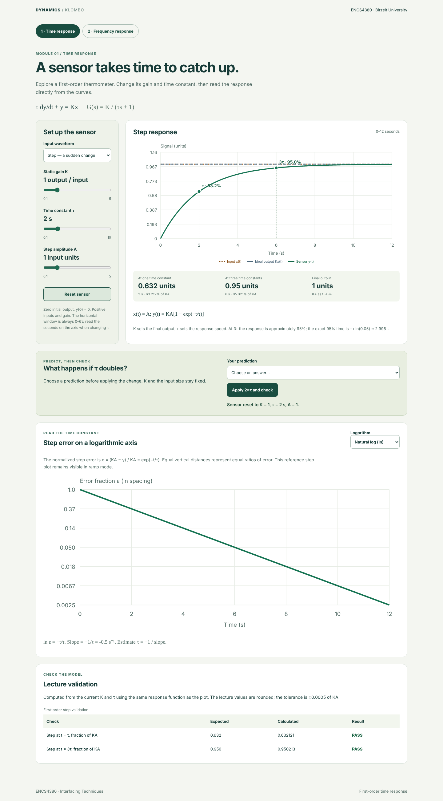

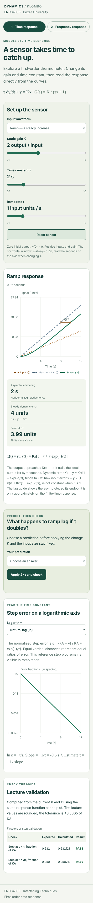

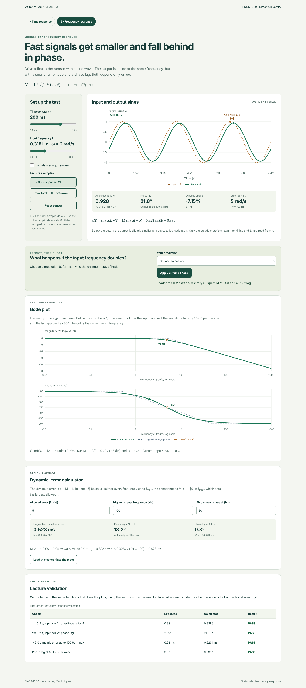

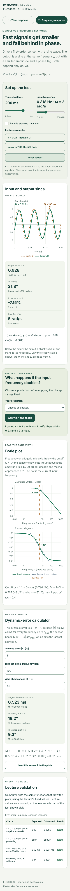

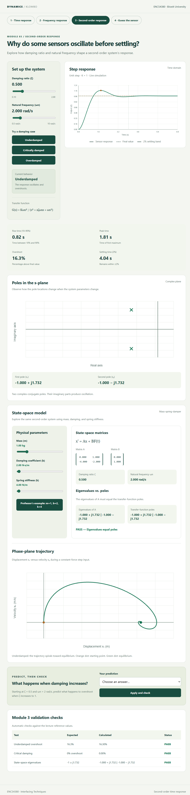

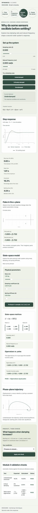

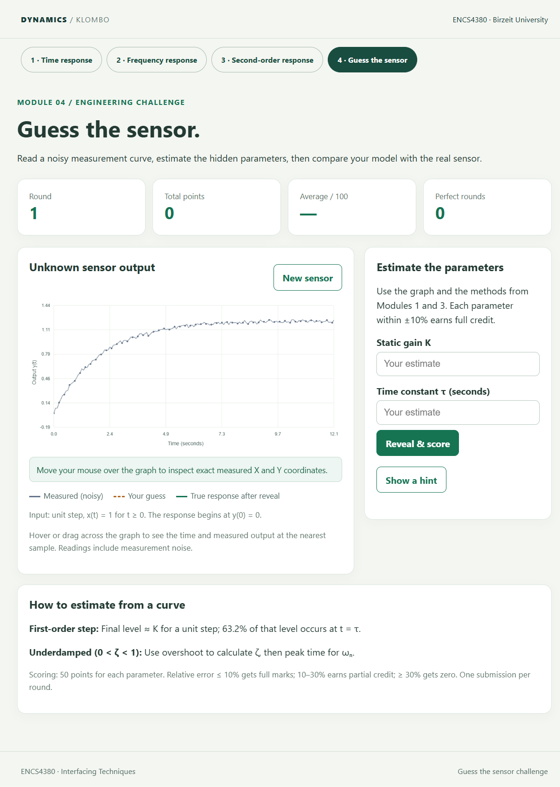

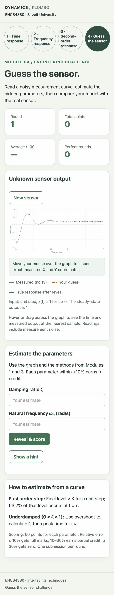

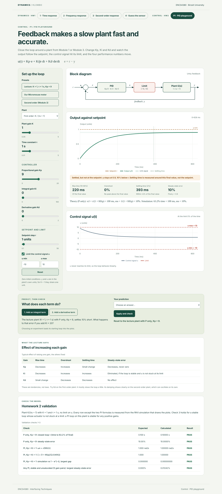

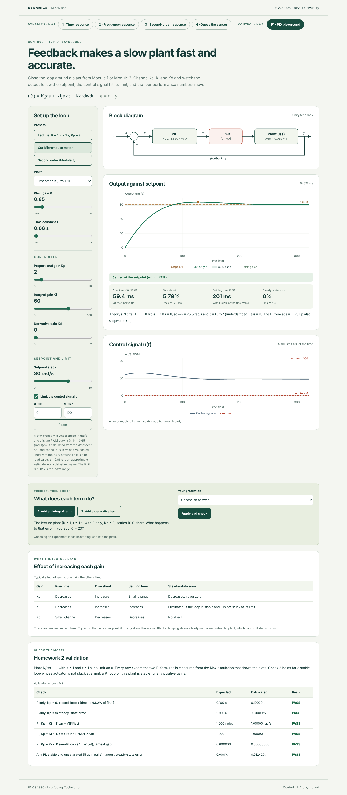

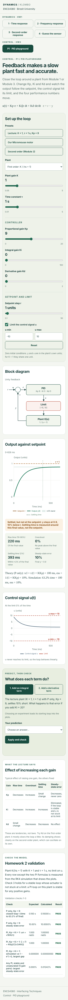

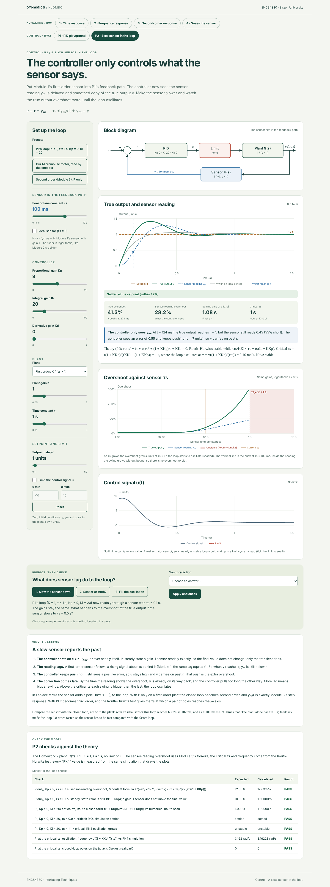

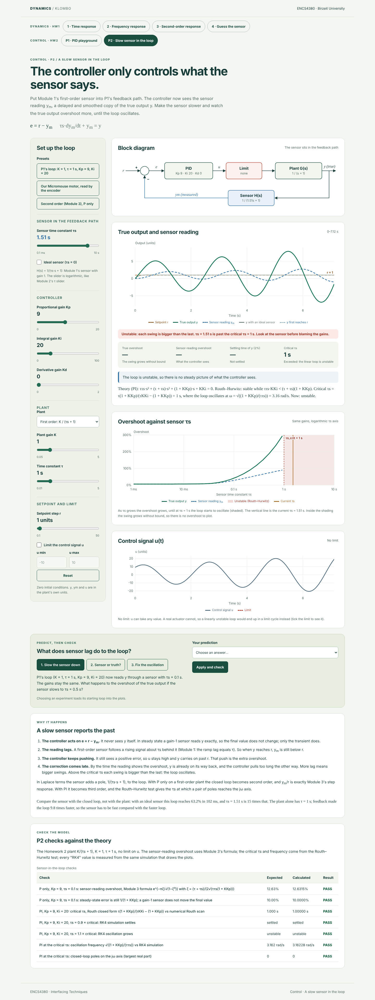

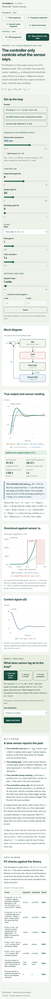

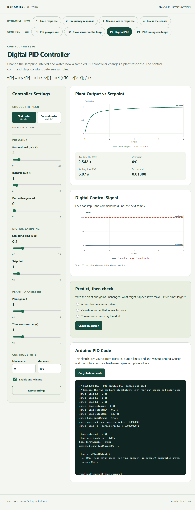

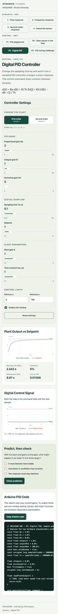

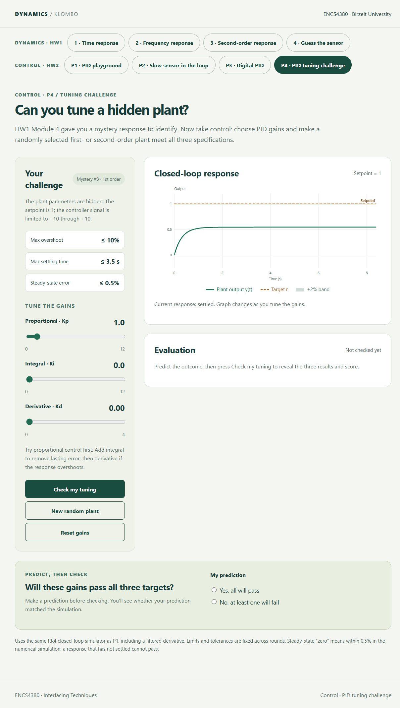

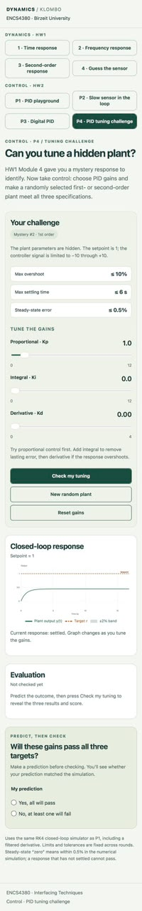


## Assistance disclosure
Claude (Anthropic) assisted with the Homework 2 P2 implementation on the website, and automated tests.OpenAI Codex assisted with Module 1 implementation, documentation, and automated tests. Claude (Anthropic) assisted with the Module 2 implementation, its tests, and documentation, and with the Homework 2 P1 implementation: the shared RK4 simulator, the P1 page, its tests, the motor datasheet search and this documentation.ChatGPT (OpenAI) assisted with Modules 3 and 4 and Homework 2 P3 and P4 implementation, calculations, interactive graphs, PID simulations, debugging, and automated testing.
